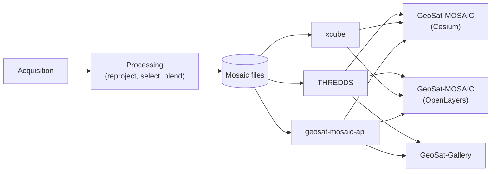

# Global Mosaic

A global cloud/imagery mosaic built from 6 geostationary satellites (GOES-18/19, Meteosat-9/10, INSAT-3DR/3DS, Himawari-9), reprojected onto a common lat/lon grid with per-pixel source selection and seam blending — served through three different viewer apps.

## Live demo

| App | URL |
|---|---|
| GeoSat-MOSAIC (Cesium, 3D globe) | [geosat-mosaic-cesium.jay-pandya.dev](https://geosat-mosaic-cesium.jay-pandya.dev) |
| GeoSat-MOSAIC (OpenLayers, 2D map) | [geosat-mosaic-openlayers.jay-pandya.dev](https://geosat-mosaic-openlayers.jay-pandya.dev) |
| GeoSat-Gallery (pre-rendered thumbnails) | [geosat-gallery.jay-pandya.dev](https://geosat-gallery.jay-pandya.dev) |

## What it is

Six geostationary satellites each stare at a fixed slice of the Earth from a different longitude. This project fetches their raw imagery, corrects for the fact that no two instruments measure quite the same wavelengths (a per-satellite spectral-response-function correction — see [wiki/Data-Processing-Pipeline.md](wiki/Data-Processing-Pipeline.md)), reprojects everything onto one shared global grid, picks the best-viewing-angle source at every pixel, and blends across satellite seams — producing a single global mosaic every processing cycle, across 6 bands (VIS, SWIR, MIR, WV, TIR1, TIR2).

The three frontend apps all read the same backend output through different serving layers: two render live map tiles (one as a 3D globe, one as a 2D map), the third animates through pre-rendered PNG thumbnails with no map tiles at all.

## Architecture



- **`backend/`** — acquisition, radiometric correction, reprojection, source selection, blending, and mosaic-file writing. Runs on a schedule via `backend/scripts/schedule_pipeline.py`.
- **`services/`** — THREDDS (cross-timestamp/point/timeseries access), xcube (map tiles), a small FastAPI service (per-satellite metadata, point-probe, timeseries), and an nginx tile cache in front of xcube.
- **`frontend/`** — the three viewer apps described above.

See [docs/README.md](docs/README.md) for the full per-module documentation index, and [wiki/](wiki/) for deeper background on the processing pipeline and radiometric correction.

## Requirements

- **Backend:** Python ≥3.10.
- **Services:** THREDDS Data Server 5.x (Java/Tomcat), xcube, FastAPI, nginx — see [docs/services/](docs/services/) for per-service setup.
- **Frontend:** Node.js + npm. All three apps are React 19 / TypeScript / Vite.

## Quick start

**Backend:**

```bash
cd backend
pip install -r requirements.txt
cp .env.example .env   # fill in EUMETSAT/MOSDAC credentials if you need Meteosat/INSAT
pytest                 # run the test suite
```

**Frontend** (any of `geosat-mosaic-cesium`, `geosat-mosaic-openlayers`, `geosat-gallery`):

```bash
cd frontend/<app>
npm install
npm run dev             # hot-reloading dev server
```

Each app's `src/lib/runtimeBackendConfig.ts` has fixed base URLs for THREDDS/xcube/`geosat-mosaic-api` — edit it directly to point at your own running services (these are not read from `.env`).

**Services:** see [docs/services/](docs/services/) — each service (THREDDS, xcube, FastAPI) has its own setup notes, and [docs/services/03-windows-deployment.md](docs/services/03-windows-deployment.md) covers the Windows Scheduled Tasks + Cloudflare Tunnel used to expose the live demo.

## Documentation

| | |
|---|---|
| [docs/README.md](docs/README.md) | Full documentation index — per-module pages for backend, services, and each frontend app, plus the technology/version tables and data credits |
| [wiki/](wiki/) | Deeper background: the end-to-end data-processing pipeline, and how the cross-satellite radiometric correction coefficients were derived |
| [CONTRIBUTING.md](CONTRIBUTING.md) | Development setup, project structure, coding conventions, and how to submit a change |

## Data credits

Source satellite data comes from NOAA/NESDIS (GOES-18/19), JMA (Himawari-8/9), EUMETSAT (Meteosat-9/10), and ISRO (INSAT-3D/3DR/3DS) — see [docs/README.md](docs/README.md#data--basemap-credits) for the full satellite and basemap credit tables.

## Known limitations

GEO-KOMPSAT-2A, Elektro-L No. 5, and Fengyun-4A are not currently acquired or mosaicked — see [docs/README.md](docs/README.md#known-limitations--future-improvements) for details.

## Contributing

See [CONTRIBUTING.md](CONTRIBUTING.md) for development setup, coding conventions, and how to submit a change. Please use the [issue templates](.github/ISSUE_TEMPLATE/) for bug reports and feature requests.

## Security

See [SECURITY.md](SECURITY.md) for how to report a vulnerability.

## License

MIT — see [LICENSE.md](LICENSE.md).
