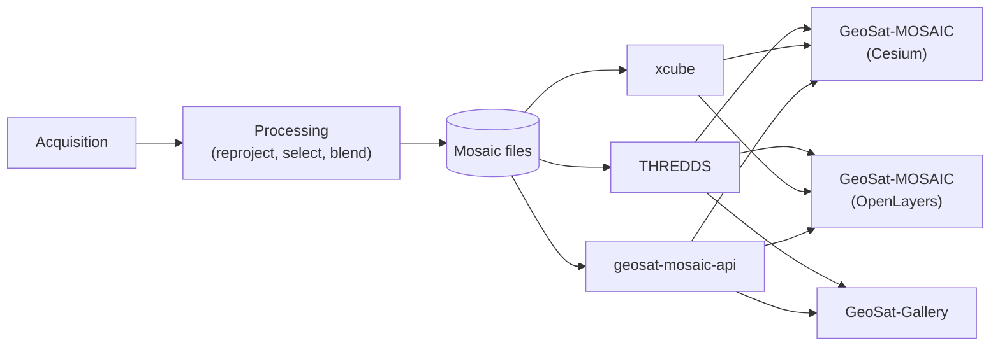
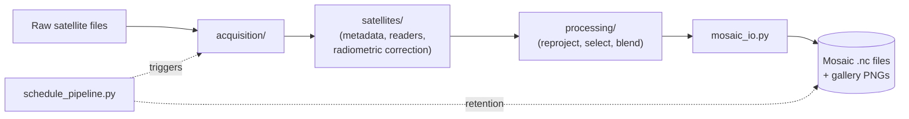
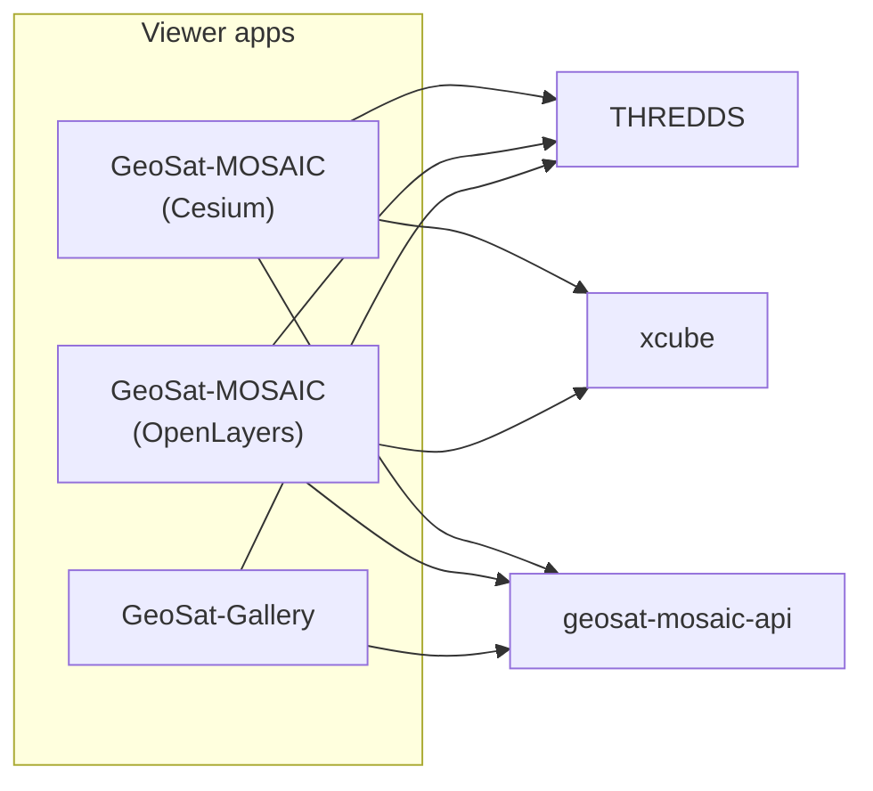

# Global Mosaic — Documentation Index

A global cloud/imagery mosaic built from 6 geostationary satellites (GOES-18/19, Meteosat-9/10, INSAT-3DR/3DS, Himawari-9), reprojected to a common lat/lon grid with per-pixel source selection and seam blending.

This index points to what each part of the codebase does and how to use it.

## Live demo

| App | URL |
|---|---|
| GeoSat-MOSAIC (Cesium) | [geosat-mosaic-cesium.jay-pandya.dev](https://geosat-mosaic-cesium.jay-pandya.dev) |
| GeoSat-MOSAIC (OpenLayers) | [geosat-mosaic-openlayers.jay-pandya.dev](https://geosat-mosaic-openlayers.jay-pandya.dev) |
| GeoSat-Gallery | [geosat-gallery.jay-pandya.dev](https://geosat-gallery.jay-pandya.dev) |

Served via a Cloudflare Tunnel — see [03-windows-deployment.md](services/03-windows-deployment.md) for the connector setup.

## System overview

## [`backend/`](backend/) — acquisition, processing, and mosaic generation

| Doc | Covers |
|---|---|
| [01-acquisition.md](backend/01-acquisition.md) | Fetching raw satellite files (GOES, Himawari, Meteosat, INSAT) |
| [02-satellites-and-readers.md](backend/02-satellites-and-readers.md) | Satellite metadata, coverage resolution, band/reader registries, cross-satellite radiometric correction |
| [03-processing-core.md](backend/03-processing-core.md) | The mosaic algorithm — timing, geometry, reprojection, selection, blending |
| [04-mosaic-io-and-gallery.md](backend/04-mosaic-io-and-gallery.md) | Writing the output files and rendering gallery thumbnails |
| [05-automation-and-scripts.md](backend/05-automation-and-scripts.md) | The CLI drivers, the scheduler, and the supporting scripts |

## [`services/`](services/) — serving the data

| Doc | Covers |
|---|---|
| [01-thredds.md](services/01-thredds.md) | THREDDS — cross-timestamp access (timeseries, point lookups) |
| [02-xcube-and-api.md](services/02-xcube-and-api.md) | xcube (map tiles) and the small FastAPI service backing per-satellite metadata, point-probe, and timeseries |
| [03-windows-deployment.md](services/03-windows-deployment.md) | Windows Scheduled Tasks that mount the data disk into WSL2 and run the Cloudflare Tunnel exposing the live demo URLs |

## [`frontend/`](frontend/) — the three viewer apps

| Doc | Covers |
|---|---|
| [01-geosat-mosaic-cesium.md](frontend/01-geosat-mosaic-cesium.md) | GeoSat-MOSAIC (Cesium) — the 3D globe viewer |
| [02-geosat-mosaic-openlayers.md](frontend/02-geosat-mosaic-openlayers.md) | GeoSat-MOSAIC (OpenLayers) — the 2D viewer |
| [03-geosat-gallery.md](frontend/03-geosat-gallery.md) | GeoSat-Gallery — the pre-rendered thumbnail viewer |

## Technologies used

**Backend** (Python, requires Python ≥3.10):

| Technology | Version |
|---|---|
| satpy, pyresample, xarray, zarr, s3fs, boto3, eumdac, cartopy, netCDF4, h5py, dask | not pinned in `requirements.txt` — installs latest compatible at install time |
| numpy | not pinned |
| requests | not pinned |
| PyYAML | not pinned |
| python-dotenv | not pinned |
| openpyxl, pytest | not pinned |

**Services:**

| Technology | Version |
|---|---|
| THREDDS Data Server (TDS) | 5.x |
| xcube | not pinned |
| FastAPI | 0.141.1 |
| Uvicorn | 0.52.1 |
| Pydantic | 2.13.4 |
| netCDF4 (Python) | 1.7.2 |
| NumPy (Python) | 2.4.1 |
| nginx | version not pinned (used as a tile-cache reverse proxy) |

**Frontend** (all three apps share this base):

| Technology | Version |
|---|---|
| React / React DOM | ^19.2.8 |
| TypeScript | ~6.0.2 |
| Vite | ^8.2.0 |
| TypeDoc (docs generation) | ^0.28.20 |

Per-app additions:

| App | Additional technology | Version |
|---|---|---|
| GeoSat-MOSAIC (Cesium) | CesiumJS | ^1.144.0 |
| GeoSat-MOSAIC (Cesium) | Resium (React bindings for Cesium) | ^1.25.0 |
| GeoSat-MOSAIC (Cesium) | vite-plugin-cesium | ^1.2.23 |
| GeoSat-MOSAIC (Cesium) | Plotly.js (dist-min) + react-plotly.js | ^3.7.0 / ^4.1.0 |
| GeoSat-MOSAIC (OpenLayers) | OpenLayers (`ol`) | ^10.10.0 |
| GeoSat-MOSAIC (OpenLayers) | Plotly.js (dist-min) + react-plotly.js | ^3.7.0 / ^4.1.0 |
| GeoSat-Gallery | *(no additional mapping/charting library — plain React)* | — |

## Data & basemap credits

**Source satellite data:**

| Satellite(s) | Operator | Data source |
|---|---|---|
| GOES-18, GOES-19 | NOAA / NESDIS | Public AWS Open Data (S3) |
| Himawari-8, Himawari-9 | JMA (Japan Meteorological Agency) | Public AWS Open Data (S3) |
| Meteosat-9, Meteosat-10 | EUMETSAT | EUMETSAT Data Store (`eumdac`) |
| INSAT-3D, INSAT-3DR, INSAT-3DS | ISRO | MOSDAC |

**Basemaps and reference geography:**

| Layer | Source |
|---|---|
| Offline base imagery (default globe basemap) | Natural Earth II, bundled with CesiumJS |
| Street-map basemap | © OpenStreetMap contributors |
| Aerial/satellite basemap | Esri World Imagery (ArcGIS Online) |
| Night-lights basemap | NASA GIBS, VIIRS City Lights (2012) |
| Coastline overlay (frontend) | Natural Earth, 50m coastline |
| Coastline / country labels (gallery thumbnails) | Natural Earth, via Cartopy (110m resolution) |
| Place search | Nominatim (OpenStreetMap) |

## Known limitations & future improvements

- **No data acquisition for GEO-KOMPSAT-2A, Elektro-L No. 5, or Fengyun-4A.** None of the three can be fetched or mosaicked today — none has a satellite-slot entry, a band mapping, or radiometric-correction coefficients, and no acquisition module exists for any of them (see [backend/01-acquisition.md](backend/01-acquisition.md) and [backend/02-satellites-and-readers.md](backend/02-satellites-and-readers.md)). GEO-KOMPSAT-2A is a partial exception: its satellite fact-table entry and a stock reader mapping already exist, but nothing acquires a file for either to use, and only 1 of its 16 real channels is even catalogued. Elektro-L No. 5 and Fengyun-4A have no footprint in the codebase at all. Tracked as a future improvement, not implemented.
