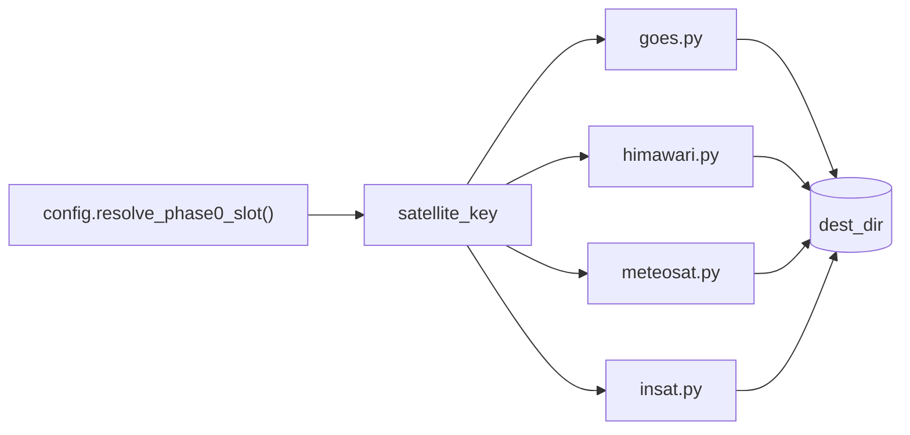

# Backend — Data Acquisition Layer

Source: `backend\src\global_mosaic\acquisition\` (`goes.py`, `himawari.py`, `meteosat.py`, `insat.py`, `_aws_common.py`) and `backend\src\global_mosaic\config.py`.

## What it does



Fetches raw satellite files onto disk. Every module exposes the same basic contract:

```python
download(satellite_key, target, dest_dir, ...) -> path(s) or None/[]
```

so callers can treat four different data sources uniformly.

| Module | Satellite family | Source | Auth needed |
|---|---|---|---|
| `goes.py` | GOES-16..19 (current) / GOES-08..15 (legacy) | Public AWS S3 / GridSat NCEI archive | None |
| `himawari.py` | Himawari-8/9 | Public AWS S3 | None |
| `meteosat.py` | Meteosat SEVIRI/MVIRI | EUMETSAT Data Store (`eumdac`) | `EUMETSAT_CONSUMER_KEY` / `EUMETSAT_CONSUMER_SECRET` env vars |
| `insat.py` | INSAT-3D/3DR/3DS | MOSDAC (ISRO) | `MOSDAC_USERNAME` / `MOSDAC_PASSWORD` env vars |

`config.py`'s `resolve_phase0_slot(slot_name, target_time)` turns a logical slot name (e.g. `"goes_east"`) plus a target time into the concrete `satellite_key` to actually fetch — acquisition modules never choose which satellite to ask for, only how to fetch a given one.

## How to use it

```python
from global_mosaic.acquisition import goes, himawari, meteosat, insat
import datetime as dt

path = goes.download("goes-19", dt.datetime(2026, 7, 30, 20, 6), "data/raw", band="C13")
paths = himawari.download("himawari-09", dt.datetime(2026, 7, 30, 20, 6), "data/raw")
paths = meteosat.download("meteosat_prime", dt.datetime(2026, 7, 30, 20, 6), "data/raw")
path = insat.download("insat-3ds", dt.datetime(2026, 7, 30, 20, 6), "data/raw")
```

For Meteosat and INSAT, set the required credentials in the environment (or a `.env` file loaded via `python-dotenv`) before calling `download()`. GOES and Himawari need no credentials — they read public AWS buckets.

`insat.download()` also works without MOSDAC credentials at all: if a file matching the expected filename convention already exists in `dest_dir`, it's used as-is, which lets manually-placed sample files flow through the same pipeline a real download would use.
