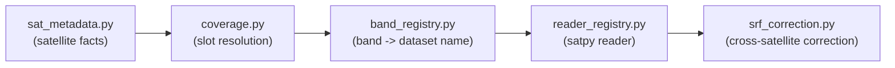

# Backend — Satellite Metadata, Coverage Resolution, Band/Reader Registries, SRF Correction, and Custom Readers

Source: `backend\src\global_mosaic\satellites\` (`sat_metadata.py`, `coverage.py`, `band_registry.py`, `reader_registry.py`, `srf_correction.py`, `srf_convolution.py`, `srf_reflectance.py`), `backend\src\global_mosaic\readers\` (`insat3d_img_l1b_h5.py`/`.yaml`, `gridsat_goes8_reader.py`/`.yaml`).

## What it does



| File | What it answers |
|---|---|
| `sat_metadata.py` | What *is* this satellite — position, operational window, channel specs (a large per-satellite fact table, `Satellites_Objects`) |
| `coverage.py` | Which satellite occupies a slot *right now*, ranked by longitude/status |
| `band_registry.py` | What satpy dataset name + calibration mode to request for a given band |
| `reader_registry.py` | What satpy reader loads a given satellite's files |
| `srf_correction.py` (+ `srf_convolution.py`/`srf_reflectance.py`) | Per-satellite gain/offset correcting for spectral-response differences between "the same" band on different satellites — the stored coefficients were derived offline via libRadtran radiative-transfer convolution, see `05-automation-and-scripts.md` |
| `readers/insat3d_img_l1b_h5.py` | Custom satpy reader for INSAT-3D/3DR/3DS L1B HDF5 files |
| `readers/gridsat_goes8_reader.py` | Custom satpy reader for the legacy GridSat GOES-08..15 archive |

## How to use it

```python
from global_mosaic.satellites import coverage, band_registry, reader_registry, srf_correction
import datetime as dt

# Which satellite currently occupies a longitude slot
candidate = coverage.resolve_slot(target_lon_deg=140.7, target_time=dt.datetime(2026, 7, 30))

# What to request from satpy for a given satellite + band
spec = band_registry.get_band_spec("goes-19", "MIR")

# Which satpy reader to use
reader = reader_registry.get_reader_spec("insat-3ds")

# Gain/offset to correct a satellite's raw value onto the shared reference scale
correction = srf_correction.get_srf_correction("insat-3ds", "WV")
corrected_value = raw_value * correction.gain + correction.offset
```

The two custom readers are registered with satpy via `SATPY_CONFIG_PATH` pointing at `readers/` — set that environment variable to this project's `readers/` directory before calling `satpy.Scene(..., reader=...)` so satpy picks them up.
