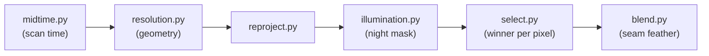

# Backend — Processing Layer, Part 1: Timing, Geometry, Reprojection, Selection, Blending

Source: `backend\src\global_mosaic\processing\` (`midtime.py`, `resolution.py`, `normalize.py`, `illumination.py`, `reproject.py`, `select.py`, `blend.py`, `tiling.py`).

## What it does



Turns several satellites' raw, differently-projected files into one per-pixel-best-source grid.

| Module | What it does |
|---|---|
| `midtime.py` | Gets each satellite's real scan mid-time by opening the file (not guessing from the filename) |
| `resolution.py` | Computes each satellite's actual per-pixel ground resolution, based on real viewing geometry |
| `illumination.py` | Masks VIS/SWIR pixels on the night side (no reflected sunlight to measure) |
| `reproject.py` | Reprojects each satellite's native grid onto a shared equirectangular grid |
| `select.py` | Picks the best-resolution satellite per pixel (with a time-sync requirement) |
| `blend.py` | Feathers the seam between winner and runner-up where their resolutions are near-tied |
| `tiling.py` | Sizes row-tiles from a memory budget so the pipeline can run within limited RAM |
| `normalize.py` | Not implemented — a stub from an earlier planning stage |

## How to use it

```python
from global_mosaic.processing import midtime, resolution, reproject, select, blend

scan_times = midtime.get_scan_times("goes-19", "path/to/file.nc")
geometry = resolution.geometry_from_orbital_parameters(loaded_dataarray.attrs["orbital_parameters"])
res_km = resolution.effective_resolution_km(geometry, lat_grid, lon_grid)

reprojected = reproject.reproject_to_cropped_grid(source_array, source_area, target_area)

result = select.select_winners_streaming(candidates)  # candidates: list of select.Candidate
final = blend.feather_seams(result)
```

`tiling.compute_row_tiles(width, height, memory_budget_gb, include_sza)` is what drives the reproject/select/blend steps in row-slices instead of holding the whole grid in memory at once — used by the driver script covered in `05-automation-and-scripts.md`, not usually called directly.
