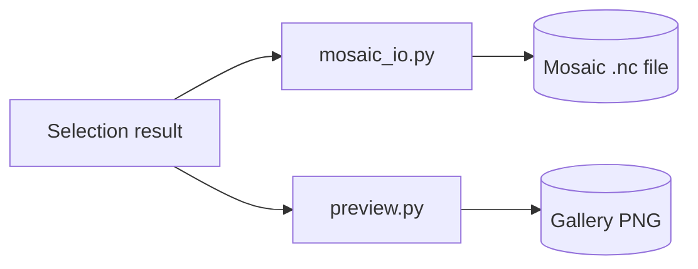

# Backend — Processing Layer, Part 2: Mosaic File I/O and Gallery Thumbnails

Source: `backend\src\global_mosaic\processing\mosaic_io.py` and `processing\preview.py`.

## What it does



Writes a finished per-pixel selection result to disk as a CF-compliant, compressed NetCDF file, and separately renders a human-viewable PNG thumbnail.

| Function | What it does |
|---|---|
| `write_mosaic_netcdf(path, ds)` | Simple full-grid write path (whole array already in memory) |
| `open_tiled_band_writer(...)` / `write_band_tile(...)` / `finalize_tiled_band_writer(...)` | Tile-major write path — writes one tile at a time without holding the whole grid in memory |
| `merge_tiled_band_files(paths, out_path, ...)` | Combines already-written per-band tiled files into one multi-band file |
| `patch_tier_file_with_satellite(...)` | Folds one newly-available satellite into an already-published file, without reprocessing every satellite |
| `render_band_preview(accumulator, band, target, out_path)` | Renders one band's gallery thumbnail PNG (fixed-range grayscale, graticule, coastlines, legend) |

Every mosaic file carries, per pixel: `satellite_id` (winning source), `is_blended`, `runner_up_satellite_id`, `blend_weight_winner`, and `pixel_resolution_km` — enough to reconstruct exactly how each pixel's value was produced.

## How to use it

```python
from global_mosaic.processing import mosaic_io, preview

mosaic_io.write_mosaic_netcdf("output.nc", dataset)

# Tile-major path
writer = mosaic_io.open_tiled_band_writer(stage_path, final_path, width, height, ...)
mosaic_io.write_band_tile(writer, tile_slice, value, satellite_id, ...)
mosaic_io.finalize_tiled_band_writer(writer, metas)

# Incrementally add one satellite to an already-published file
mosaic_io.patch_tier_file_with_satellite(nc_path, band, value, resolution_km, columns, meta)

# Render a gallery thumbnail
preview.render_band_preview(accumulator, "mir", target_time, "gallery/mir/preview.png")
```
