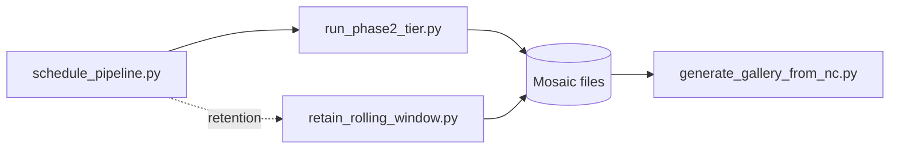

# Backend — Automation Layer: `run_phase2_tier.py` and `schedule_pipeline.py`, Retention, and Supporting Scripts

Source: `backend\scripts\run_phase2_tier.py`, `backend\scripts\schedule_pipeline.py`, `backend\scripts\retain_rolling_window.py`, `backend\scripts\generate_gallery_from_nc.py`, `backend\scripts\preview_mosaic_png.py`, `backend\scripts\run_phase0.py`.

## What it does



| Script | What it does |
|---|---|
| `run_phase2_tier.py` | Builds one complete mosaic for one tier and one target timestamp |
| `schedule_pipeline.py` | Recurring driver — decides when and for which timestamp to run `run_phase2_tier.py`, and applies retention |
| `retain_rolling_window.py` | Deletes files older than a rolling window, keeping the newest N |
| `generate_gallery_from_nc.py` | Regenerates gallery PNGs from an already-written `.nc` file |
| `preview_mosaic_png.py` | Dumps a full-resolution, lossless debugging PNG from a mosaic file |
| `run_phase0.py` | Original single-band proof-of-concept, superseded by `run_phase2_tier.py` |

## How to use it

Build one mosaic manually:

```bash
python scripts/run_phase2_tier.py A "2026-07-30T20:06:00" --blend-margin-km 5.0
```

`tier` is `A` (MIR/WV/TIR1/TIR2 @ 2km) or `B` (VIS/SWIR @ 1km). `target` is an ISO 8601 timestamp.

Run the recurring scheduler (intended to be invoked on a timer, e.g. every ~20 minutes):

```bash
python scripts/schedule_pipeline.py --final-out-dir /path/to/mosaics/tiera --gallery-dir /path/to/mosaics/gallery
```

Useful flags: `--max-wait-hours` (force-process once this long has passed even with a satellite missing, default 24), `--catchup-wait-hours` (how long to keep rechecking for a missing satellite before giving up, default 168 = 7 days), `--retention-keep` (rolling-window size, default 672 = 4/hour × 24h × 7 days).

Retain only the newest N files in a directory:

```bash
python scripts/retain_rolling_window.py --dir /path/to/mosaics/tiera --keep 672
```

Regenerate gallery thumbnails from existing files:

```bash
python scripts/generate_gallery_from_nc.py path/to/tiera_*.nc --gallery-dir /path/to/mosaics/gallery
```

The offline SRF-derivation tooling (`compute_srf_correction.py`, `compute_srf_correction_vis_swir.py`, `convert_nwpsaf_profiles.py`, `spot_check_wv_empirical_overlap_bias.py`) is one-off tooling used only when recomputing the coefficients checked into `srf_correction.py` — not part of the regular pipeline, and never invoked by `run_phase2_tier.py` or `schedule_pipeline.py`.

The two `compute_srf_correction*.py` scripts additionally require a working **libRadtran** install (with REPTRAN, Mie, and Baum data) to run their radiative-transfer convolution — see each script's own docstring. They assume it's reachable via `wsl.exe` from Windows at the path in the `LIBRADTRAN_ROOT` environment variable (override if installed elsewhere; edit each script's `UVSPEC_CMD`/subprocess call instead if running directly inside WSL/Linux). The real filter-response/reference-spectrum data files these scripts convolve against are documented separately in [`docs/research/srf_data/README.md`](../research/srf_data/README.md).
