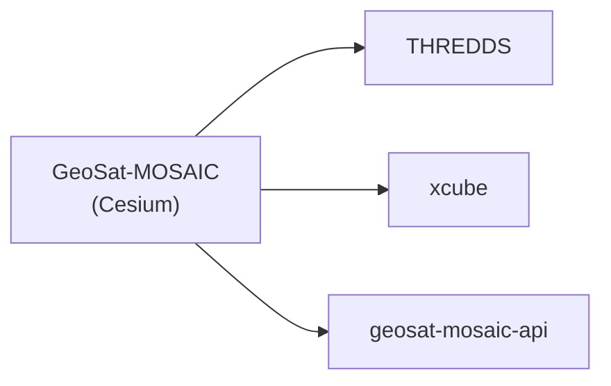

# GeoSat-MOSAIC (Cesium)

Source: `frontend\geosat-mosaic-cesium\`.

## What it does



A React + CesiumJS 3D globe viewer for the mosaic: animation through available timestamps, toggleable layers (basemap, coastline, mosaic, per-satellite contribution mask), point-probe (per-pixel value + contributing satellite), a timeseries chart, measurement tools, place search, and an About panel listing the source-satellite and basemap/overlay data credits (also surfaced natively via Cesium's own credit display, since every imagery layer carries a `credit`).

## How to use it

```bash
cd frontend/geosat-mosaic-cesium
npm install
npm run dev            # dev server
npm run build           # production build
npm run preview         # serve the production build locally
npm run docs             # generate API docs (TypeDoc) into api-docs/
```

Backend base URLs are **not** read from `.env` — `src/lib/runtimeBackendConfig.ts` returns fixed base URLs for THREDDS, xcube, and `geosat-mosaic-api` (see `services/`). Edit that file directly to point the app at your own running services.
