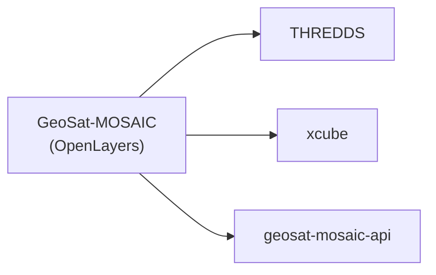

# GeoSat-MOSAIC (OpenLayers)

Source: `frontend\geosat-mosaic-openlayers\`.

## What it does



A React + OpenLayers 2D viewer for the mosaic — the same feature set as the Cesium app (layers, animation, point-probe, timeseries, measurement tools, place search, an About panel with data/basemap credits) in a 2D-only view, using a plain EPSG:4326 projection to match the data's native grid. The map-rotate control is omitted on touch/mobile devices — north-alignment isn't needed there and the control's own auto-hide behavior wasn't reliably touch-friendly.

## How to use it

```bash
cd frontend/geosat-mosaic-openlayers
npm install
npm run dev
npm run build
npm run preview
npm run docs             # generate API docs (TypeDoc) into api-docs/
```

Backend base URLs are **not** read from `.env` — `src/lib/runtimeBackendConfig.ts` returns fixed base URLs for THREDDS, xcube, and `geosat-mosaic-api` (see `services/`). Edit that file directly to point the app at your own running services.
