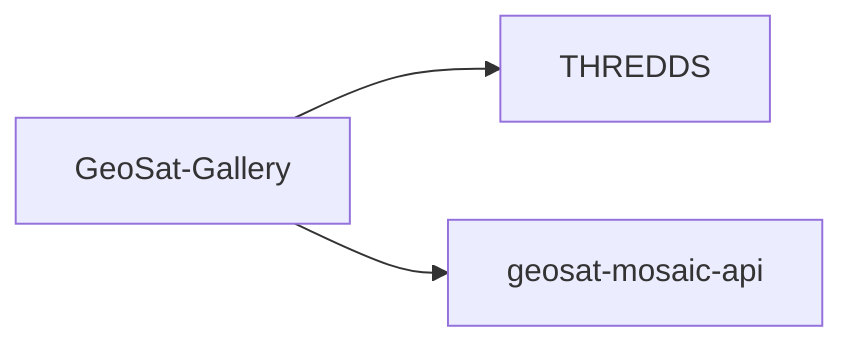

# GeoSat-Gallery

Source: `frontend\geosat-gallery\`.

## What it does



A simpler React viewer with no live map tiles — it animates through pre-rendered gallery PNG thumbnails for a selected band, resolved from a THREDDS catalog listing. It also calls `geosat-mosaic-api` on demand for its info panel's per-satellite metadata table (not per animation frame).

## How to use it

```bash
cd frontend/geosat-gallery
npm install
npm run dev
npm run build
npm run preview
npm run docs             # generate API docs (TypeDoc) into api-docs/
```

Backend base URLs are **not** read from `.env` — `src/lib/runtimeBackendConfig.ts` returns fixed base URLs for THREDDS and `geosat-mosaic-api` (see `services/`). Edit that file directly to point the app at your own running services.
