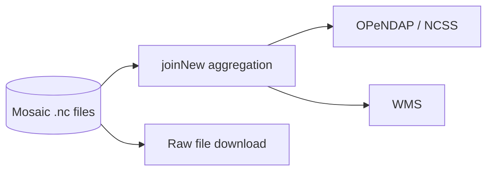

# THREDDS

Source: `services\thredds\`.

## What it does

Serves the mosaic `.nc` files for cross-timestamp access — a `joinNew` NcML aggregation stacks each single-timestamp file into a `(time, y, x)` view, giving time-series and OPeNDAP-style access that no single file has on its own. It also serves the raw files directly for download.

Two limitations worth knowing before using it:

- Classic OPeNDAP (DAP2) has no 64-bit integer type, so the `int64`/`datetime64` scan-time fields are excluded from the aggregated view (they're still readable directly from the raw files via NCSS or plain `netCDF4`/`xarray`).
- THREDDS's NCSS "grid-as-point" endpoint is not safe to use against this data — it can silently return the wrong pixel or crash the server. Do point lookups against the raw files directly instead (see `02-xcube-and-api.md`'s FastAPI service, which does exactly this).

## How to use it

Point a `catalog.xml` `datasetScan`/aggregation at a directory of `tiera_<timestamp>.nc` files, then access:

- `GET /thredds/dodsC/<dataset>` — OPeNDAP access (e.g. via `xarray.open_dataset(url)`)
- `GET /thredds/wms/<dataset>` — WMS tile/map access
- `GET /thredds/ncss/grid/<dataset>` — NetCDF Subset Service (bounding-box/variable subsetting) — safe for grid subsets, not for single-point lookups
- `GET /thredds/fileServer/<raw-dataset>/<file>` — direct file download, via a separate `datasetScan` pointed at the raw files

Configuration lives in `catalog.xml` (the aggregation and variable list) and `threddsConfig.xml` (server-wide settings, mostly left at defaults).
