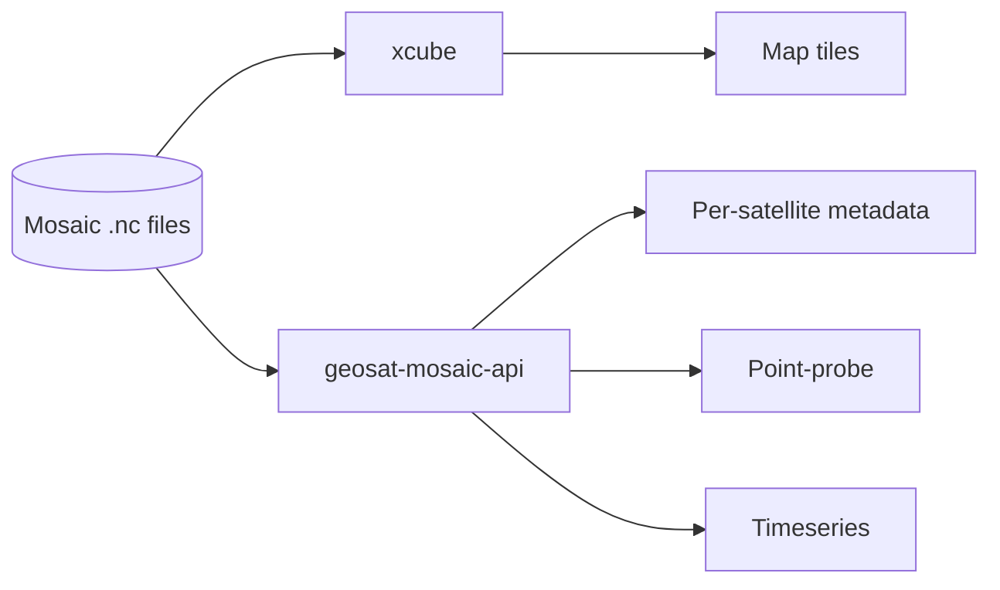

# xcube and geosat-mosaic-api

Source: `services\xcube\`, `services\fastapi\`.

## What it does



**xcube** serves map tiles for the mosaic files directly (dynamic colormap/range via query params, categorical rendering for the per-satellite contribution mask). It's launched through a small wrapper (`serve_wrapper.py`) that applies a few patches: a bounded dataset cache (the stock library keeps every opened dataset resident forever with no eviction), an async `/datasets` route, and a coordinate-augmentation hook so `lat`/`lon` are usable as real dimension names.

**`geosat-mosaic-api`** (FastAPI, `main.py`) serves the things neither THREDDS nor xcube can: per-satellite metadata, single-pixel point lookups, and timeseries — all read directly from the raw `.nc` files via `netCDF4`, dispatched through a process pool (not threads — `netCDF4`/HDF5 isn't thread-safe for concurrent access).

## How to use it

**xcube tile endpoint:**

```
GET /tile2/<dataset>/<variable>/<z>/<y>/<x>?cbar=<colormap>&vmin=<min>&vmax=<max>
```

Config lives in `config.yml`, pointing xcube at the same directory of `.nc` files THREDDS reads. Each matching file shows up as its own dataset (no automatic time-concatenation the way THREDDS's aggregation does).

**FastAPI endpoints** (`geosat-mosaic-api`):

| Endpoint | Params | Returns |
|---|---|---|
| `GET /satellite-metadata` | `band`, `time` | Per-satellite metadata table for that band/timestamp |
| `GET /minmax` | `band`, `time` | True min/max of the packed data (for auto-ranging a colorbar) |
| `GET /point-probe` | `band`, `time`, `lat`, `lon` | Value + contributing satellite at one point |
| `POST /timeseries` | body: band, list of timestamps, lat/lon | Value at one point across multiple timestamps |

Run it directly with `uvicorn main:app --host 0.0.0.0 --port 8001`, after installing `services/fastapi/requirements.txt`.
