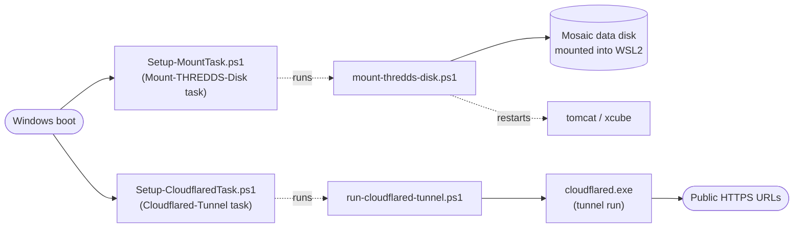

# Windows Deployment Scripts

Source: `services\windows\`.

## What it does



Two independent Scheduled-Task pairs handle the parts of the deployment that only make sense on a real Windows boot — attaching the physical data disk into WSL2, and exposing the WSL2-hosted services to the public internet — both designed around the same boot-timing problem: a task firing at startup can't assume the network or removable storage is actually ready yet.

| Script | What it does |
|---|---|
| `Setup-MountTask.ps1` | Registers the `Mount-THREDDS-Disk` scheduled task (`AtStartup`, S4U logon) |
| `mount-thredds-disk.ps1` | The task's actual action — retries disk enumeration for ~2 minutes (a USB SSD isn't always visible instantly at boot), attaches it into WSL2 via `wsl --mount --bare`, mounts it inside WSL2's real init namespace via `nsenter` (a plain `wsl.exe` interop call can land in a throwaway mount namespace THREDDS/xcube never see), then restarts `tomcat`/`xcube` so they pick up the now-available data (`geosat-mosaic-api` doesn't need this — it reads files per-request with no startup-time cache) |
| `Test-MountTask.ps1` | Manually triggers the mount task and tails its log, for testing without a reboot |
| `Setup-CloudflaredTask.ps1` | Registers the `Cloudflared-Tunnel` scheduled task. Runs as a real logged-on user via S4U rather than `cloudflared`'s native Windows service, which was observed to crash-loop indefinitely under `LocalSystem` in this environment |
| `run-cloudflared-tunnel.ps1` | The tunnel task's actual action — waits for real DNS/network readiness (a boot-time launch otherwise fails cloudflared's edge-discovery lookup and exits immediately), then launches `cloudflared.exe tunnel run` and restarts it itself on any exit, since the scheduled task's own `RestartCount`/`RestartInterval` settings were observed not to actually retry after a boot-time failure |

## How to use it

Register both tasks once, as an administrator, after `cloudflared` is installed and `.cloudflared\config.yml` is configured with the tunnel's routes:

```powershell
.\Setup-MountTask.ps1
.\Setup-CloudflaredTask.ps1
```

Both replace their `<windows-username>` placeholder with the real account the task should run as before registering — see each script's own `New-ScheduledTaskPrincipal` line. `mount-thredds-disk.ps1` also has a `<DISK_SERIAL_NUMBER>` placeholder identifying which physical disk to attach.

Verify without rebooting:

```powershell
.\Test-MountTask.ps1
Start-ScheduledTask -TaskName "Cloudflared-Tunnel"; Get-Content C:\Scripts\run-cloudflared-tunnel.log -Tail 10
```

Both scripts log to `C:\Scripts\*.log` (`mount-thredds-disk.log`, `run-cloudflared-tunnel.log`) for post-boot troubleshooting, since neither task runs in an interactive session where console output would be visible.
