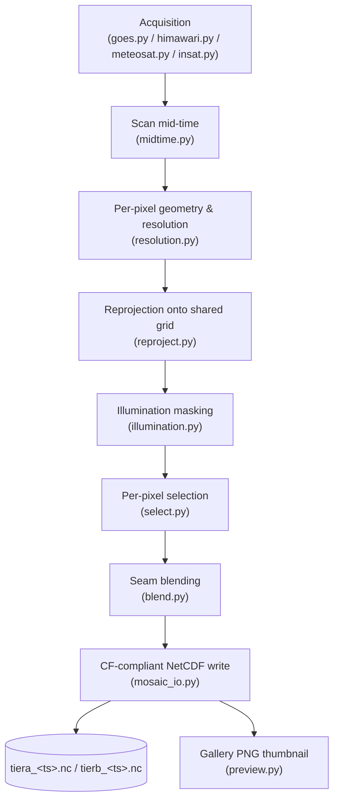

# Data Processing Pipeline

How Global Mosaic turns raw per-satellite imagery into a shared-grid,
CF-compliant NetCDF mosaic — from acquisition through the on-disk file
format, including the exact compression scheme used to keep files small.



## 1. Data acquisition

`backend/src/global_mosaic/acquisition/` — one module per satellite
family, all exposing the same `download(satellite_key, target, dest_dir, ...)`
contract so the rest of the pipeline can treat four different data sources
uniformly:

| Module | Satellite family | Source | Auth |
|---|---|---|---|
| `goes.py` | GOES-16..19 (current) / GOES-08..15 (legacy) | Public AWS S3 / GridSat NCEI archive | None |
| `himawari.py` | Himawari-8/9 | Public AWS S3 | None |
| `meteosat.py` | Meteosat SEVIRI/MVIRI (Prime + IODC) | EUMETSAT Data Store (`eumdac`) | `EUMETSAT_CONSUMER_KEY` / `EUMETSAT_CONSUMER_SECRET` |
| `insat.py` | INSAT-3D/3DR/3DS | MOSDAC (ISRO) | `MOSDAC_USERNAME` / `MOSDAC_PASSWORD` |

`global_mosaic.config.resolve_phase0_slot(slot_name, target_time)` maps a
logical slot (e.g. `"goes_east"`) plus a target time to the concrete
satellite currently occupying that slot — so a GOES-16→19 handover or a
Meteosat-10/11 role swap needs no code change, just an updated coverage
window in `sat_metadata.py`.

For each of the 6 logical slots, the driver acquires the nearest available
file within a **±5 minute search window** of the target timestamp. INSAT
additionally supports resolving to whichever generation (3DR vs 3DS) has
the nearer real scan time, which roughly halves its effective cadence
compared to using either generation alone.

## 2. Scan timing

`processing/midtime.py` opens each acquired file and computes its **real
scan mid-time** — never guessed from the filename alone, since filename
timestamps mean different things per instrument (nominal slot start,
scan end minus a fixed offset, etc.). GOES is the one family whose
mid-time is recoverable from Scene-level `start_time`/`end_time` alone;
every other family requires reading real per-file or per-line timing
fields to get an accurate value.

## 3. Per-pixel geometry & actual resolution

`processing/resolution.py` computes each satellite's *actual* per-pixel
ground resolution — not just its nominal nadir figure — from real viewing
geometry:

1. **View zenith angle (VZA)** at the ground point, from the satellite's
   sub-satellite longitude/latitude/altitude (preferring the file's own
   `satellite_actual_*` orbital parameters over the nominal slot position,
   since geostationary satellites station-keep within a small box around
   their nominal slot rather than sitting exactly on it).
2. **Two multiplicative degradation factors**, both growing toward the
   limb: range magnification (`r_s / H`, footprint grows with slant
   range) and oblique-view elongation (`1 / cos(VZA)`, the footprint
   projects onto the surface at an angle).

```
effective_resolution = nadir_resolution * (r_s / H) / cos(VZA)
```

This per-pixel resolution value is the deciding factor in per-pixel
selection (§5) and is stored directly in the output file so it's clear
exactly how sharp each pixel's contributing observation actually was.

## 4. Reprojection

`processing/reproject.py` reprojects each satellite's native
geostationary-projection grid onto one shared rectilinear
equirectangular grid, at one of two fixed resolutions depending on tier
(§6). Source-side cropping and pyresample neighbour-info caching keep
this affordable across dozens of full-disk reprojections per run.

## 5. Illumination masking

`processing/illumination.py` masks VIS/SWIR pixels on the night side of
the target time — there is no reflected sunlight for a passive optical
sensor to measure there, so those pixels are excluded from
consideration rather than reported as a (meaningless) zero reading.

## 6. Per-pixel selection

`processing/select.py` picks one winning satellite per pixel using a
two-stage rule:

1. **Time-sync filter**: among satellites with valid data at a pixel,
   only those within an optional configured `sync_threshold_seconds` of
   the best-synced candidate this run are eligible at all. Left `None`
   (the default), every candidate stays eligible and sync plays no
   filtering role — resolution alone decides.
2. **Finest actual resolution wins**: among sync-eligible candidates,
   the one with the best per-pixel `resolution.py` value (not nominal
   nadir resolution) wins that pixel.

The runner-up (second-best) satellite, its resolution, and whether the
winner/runner-up resolutions were within `blend_margin_km` of each other
(a **tie**) are all retained for the next stage and for on-disk
accountability.

## 7. Seam blending

`processing/blend.py` feathers the hard winner/runner-up cut only at
pixels `select.py` flagged as a near-tie, weighted by inverse actual
resolution (the sharper source contributes more):

```
blended = (w_winner * value_winner + w_runner * value_runner) / (w_winner + w_runner)
where w = 1 / resolution_km
```

Because actual resolution is itself derived from view-zenith angle, this
inverse-resolution weighting achieves the same effect as an
inverse-view-zenith blend without threading view angle through as a
separate value. Every pixel outside the tie mask is an unmodified,
single-source hard cut.

## 8. Tiers, bands, and grid resolution

Bands are split into two tiers, each written as its own multi-band file
at its own grid resolution:

| Tier | Bands | Grid resolution | Approx. grid size |
|---|---|---|---|
| **A** | MIR, WV, TIR1, TIR2 | 2.0 km | ~148M pixels |
| **B** | VIS, SWIR | 1.0 km | ~593M pixels |

Both tiers run against the same 6 logical satellite slots and the same
selection/blending algorithm above — the split exists purely because
VIS/SWIR's native resolution genuinely supports a finer shared grid than
the thermal bands, and because Tier B's larger grid needs a different
memory-management strategy (row-tiling + per-satellite subprocess
isolation) than Tier A's in-process path.

## 9. NetCDF output format and CF compliance

`processing/mosaic_io.py` writes each tier's finished result as one
`Conventions: CF-1.8` NetCDF4 file, via either a simple full-grid write
path or a tile-major streaming writer (for grids too large to hold
entirely in memory).

### Dimensions and coordinates

- `y`, `x` — the shared target grid, in row/column order.
- `lat(y)`, `lon(x)` — genuine 1D CF coordinates, not a needlessly-repeated
  2D array: the target grid is rectilinear (lat varies only by row, lon
  only by column). Collapsing to 1D loses no information (a 2D value is recovered via
  ordinary broadcasting) and measurably shrinks the file — the
  repeated-longitude-row alone was ~4.3–4.7% of a Tier B file's size
  before this was fixed.
- `satellite` — one entry per satellite contributing to this file, keyed
  by an integer `satellite_id`.
- `time` (scalar) — the **median** scan mid-time across contributing
  satellites (median, not mean, for robustness to one oddly-timed
  satellite like INSAT's ~30 min cadence skewing an average). This is
  the mosaic's authoritative timestamp; `requested_target_time` (a global
  attribute) records what was actually asked for.

### Per-band variables (band-suffixed, e.g. `_mir`, `_wv`, `_tir1`, `_tir2`)

| Variable | Meaning |
|---|---|
| `value_<band>` | The selected/blended physical value (reflectance %, radiance, or brightness temperature K depending on band). |
| `satellite_id_<band>` | Integer id of the winning satellite at each pixel. |
| `is_blended_<band>` | Whether this pixel was feathered (tie) vs. a hard single-satellite cut. |
| `runner_up_satellite_id_<band>` | The second-place satellite at tie pixels (so a blended pixel's true per-satellite inputs stay reconstructable). |
| `blend_weight_winner_<band>` | Winner's blend weight (`1.0` wherever `is_blended=0`) — lets `value = w*winner + (1-w)*runner_up` reconstruct the exact pre-blend values. |
| `pixel_resolution_km_<band>` | Actual per-pixel ground resolution of the winning observation (§3). |

Per-satellite-dimensioned metadata (one row per contributing satellite,
not per pixel) is stored alongside: `satellite_longitude`,
`satellite_scan_start/end/mid`, `satellite_key`, `satellite_source_filename`,
`satellite_nominal_spatial_resolution_km`, `satellite_band_center_wavelength_um`,
`satellite_temporal_resolution_minutes`, and the SRF-correction disclosure
fields `satellite_srf_correction_gain/offset/method` (identity
gain=1.0/offset=0.0/method="identity" when no cross-satellite radiometric
correction was applied to that satellite's contribution).

### Global attributes

`Conventions`, `title`, `history` (generation timestamp + module),
`requested_target_time`, `references` (points at the source-code module
holding the authoritative per-satellite technical specifications),
`srf_correction_enabled`, `srf_correction_schema_version`, and
`srf_correction_reference`.

## 10. Compression: scale factor / offset and file size

Every float variable is packed to **int16** using the standard CF
packed-data convention (`unpacked = add_offset + scale_factor * packed`),
then zlib-compressed:

- **Packing range**: the actual finite min/max of each variable's data
  this run is mapped symmetrically onto `[-32767, +32767]`
  (`int16`'s range minus one end, which is reserved as the fill value)
  — not `[0, 65534]`, which would silently overflow a *signed* int16.
  `add_offset` is centered at the midpoint of the real range so that
  `pack(min) = -32767` and `pack(max) = +32767` exactly:

  ```
  scale_factor = (max - min) / (2 * 32767)
  add_offset   = (min + max) / 2
  ```

  This adapts per band/run to whatever physical range is actually
  present (reflectance %, radiance, brightness temperature K, or km),
  rather than one fixed scale tuned for a single unit.

- **Fill values**: `-32768` (int16 min) for packed float fields;
  `-1` for the categorical int8 fields (`satellite_id`, `is_blended`,
  `runner_up_satellite_id`) — deliberately *not* `0`, since `0` is itself
  a real, common value for those fields (no coverage / not blended / no
  runner-up), and reusing it as the fill value would make
  netCDF4/xarray's default read-side auto-masking silently corrupt every
  legitimate zero into `NaN`.

- **Compression level**: zlib level **4**, chosen after direct
  measurement against level 9 on real Tier A/B output files — level 9 is
  a lossless recompression of the same packed int16 bytes (no
  precision/accountability difference) that saves only **~7.5% combined
  file size** (Tier A −5.9%, Tier B −8.9%) for roughly **double the write
  time**, a bad trade for files meant to be re-opened often rather than
  archived once and never read again.

## 11. File naming and directory layout

```
data/mosaics/
  tiera_<YYYYMMDD>T<HHMMSS>.nc      # Tier A: MIR/WV/TIR1/TIR2, 2km grid
  tierb_<YYYYMMDD>T<HHMMSS>.nc      # Tier B: VIS/SWIR, 1km grid

data/mosaics/gallery/
  tiera/{mir,wv,tir1,tir2}/<band>_<YYYYMMDDTHHMMSS>_<scanTimeYYYYMMDDTHHMMSS>.png
```

The timestamp is the target time the run was scheduled for (matching the
scan-time-driven `±5 minute` search window in §1), not the file's actual
write time. `<timestamp>` in each filename is also the aggregation key
THREDDS's NcML `joinNew` catalog uses (via a `dateFormatMark` matching
this exact pattern) to stitch the rolling window of single-timestamp
files into one virtual time-varying dataset for OPeNDAP/WMS/NCSS access,
without ever rewriting or concatenating the underlying files on disk.

A rolling retention window (7 days / a fixed file count, applied
independently to the raw `tiera_*.nc`/`tierb_*.nc` directories and each
band's gallery subdirectory) deletes the oldest files as new ones land,
keeping total on-disk size bounded regardless of how long the pipeline
has been running.

## Incremental patching

Because acquisition cadences differ per satellite family (~10–15 min for
GOES/Himawari/Meteosat vs. ~15–30 min for INSAT), a tier file is
sometimes published before every satellite is available. Rather than
reprocessing the whole tier once a late satellite lands,
`mosaic_io.patch_tier_file_with_satellite()` folds just that one
satellite's contribution into the already-published file in place —
re-running selection/blending only for the pixels that satellite could
plausibly win, and updating the same per-satellite metadata table and
disclosure fields described in §9.

## 12. Background: how the SRF cross-satellite correction coefficients were derived

**This is an offline, one-time calibration step, not part of the live
per-run pipeline above.** `run_phase2_tier.py`/`schedule_pipeline.py`
never invoke it — they only look up the already-computed static
coefficients via `srf_correction.get_srf_correction(satellite_key, band)`
and apply `value_corrected = value_raw * gain + offset` (§9's
`satellite_srf_correction_*` disclosure fields record exactly what was
applied, if anything).

### Why it's needed

Mosaicking different satellites' "same" band together silently
juxtaposes sensors whose actual spectral response differs — two
satellites observing the identical real scene disagree not because one
is wrong, but because their filter passbands (spectral response
functions, SRFs) weigh the underlying spectrum differently. SRF
correction isolates and removes exactly that spectral-shape effect,
mapping every satellite's raw value onto **goes-19**'s scale (the anchor
satellite for every band).

### Thermal bands (WV/MIR/TIR1/TIR2): SRF-weighted radiative transfer

For a thermal band, what a satellite channel "measures" is top-of-
atmosphere spectral radiance weighted by that channel's real SRF curve,
then inverted through the Planck function to an equivalent brightness
temperature:

```
L_channel  = integral(SRF(v) * L_TOA(v) dv) / integral(SRF(v) dv)
BT_channel = inverse_planck(L_channel, v_ref)
```

`v_ref` is each channel's own SRF response-weighted centroid wavenumber
(not a full-band integration) — the same single-wavenumber convention
every satellite's own onboard calibration already uses.

Two satellites observing the same real scene disagree only because their
SRF curves differ — convolving the **same** `libRadtran`-computed
`L_TOA(v)` spectrum against each satellite's own real SRF curve isolates
exactly that spectral-shape effect:

1. `backend/scripts/compute_srf_correction.py` drives `libRadtran`'s
   `uvspec` (requires a real local install — REPTRAN, Mie, and Baum
   data — reachable via `wsl.exe` from Windows, path configured via the
   `LIBRADTRAN_ROOT` environment variable) across an **atmospheric-profile
   ensemble**: 80 real ECMWF profiles from EUMETSAT NWP SAF's
   `ECMWF_83P_91L.dat` (the 3 remaining "profiles" in that 83-profile set
   are synthetic min/max/mean envelope statistics, deliberately excluded
   — not real individual atmospheric states). An earlier v1 used
   libRadtran's own 6 bundled AFGL standard atmospheres (tropical,
   mid-latitude summer/winter, subarctic summer/winter, US standard)
   before the full NWP SAF set was converted; the 6-AFGL run is kept
   available for regression comparison.
2. Each satellite's real SRF curve (from EUMETSAT NWP SAF's
   RTTOV-coefficient-format files for INSAT/Meteosat, NOAA's GOES-R ABI
   CWG files for GOES) convolves against that same per-profile TOA
   spectrum, per `satellites/srf_convolution.py`'s `convolve_srf_with_spectrum`.
3. The **mean bias** across the ensemble becomes the stored `gain`/`offset`
   (gain is currently always `1.0` — every computed correction is a pure
   offset); the **spread** across ensemble members is stored as
   `reference_ensemble_spread`, a disclosed diagnostic only, never
   applied at correction time.

A known, non-blocking caveat: the NWP SAF-profile-to-libRadtran-
atmosphere-file converter (`convert_nwpsaf_profiles.py`) has a ~1.3%
cumulative altitude-integration imprecision, which largely cancels out
since this is a *differential* measurement (both satellites in a pair
are fed the identical converted profile).

### Reflective bands (VIS/SWIR): SRF-weighted solar reflectance

No radiative-transfer atmosphere simulation here (v1 deliberately has no
atmospheric-transmittance term for these bands) — instead, a 6-member
reflectance-target ensemble via `compute_srf_correction_vis_swir.py`:

```
R_channel = pi * integral(SRF(l) * E_solar(l) * rho_target(l) dl)
            / integral(SRF(l) * E_solar(l) dl)
```

- **4 analytic surface targets** (desert, snow/ice, vegetation, water):
  pure SRF × solar-spectrum × target-reflectance convolution, no
  `libRadtran` call at all. Solar spectrum is LASP's TSIS-1 HSRS v2
  (resampled to 1nm); target reflectance spectra are real USGS Spectral
  Library (`splib07a`) samples — the "desert" target is a generic sand
  sample standing in for PICS Libya-4 (Libya-4's own characterized
  reflectance wasn't obtained).
- **2 cloud targets** (liquid Mie, ice Baum): these *do* run a real
  `uvspec` solar-mode simulation with `no_absorption mol` (disables only
  molecular/gas absorption, preserving the cloud's own scattering and
  absorption — the actual physical signal these bands exist to sense),
  at a representative 30° solar zenith angle. Raw radiance is converted
  to reflectance via `R = pi*L/(E_solar*cos(sza))` using TSIS-1's own
  irradiance at each wavelength, then convolved against each satellite's
  SRF the same way as the analytic targets.

### Validation and a real caught bug

An independent "empirical-overlap-bias" spot-check
(`spot_check_wv_empirical_overlap_bias.py`, validation-only — never a
stored `method` value) compared real overlapping INSAT-3DS/Himawari-9
observations against the RT-derived coefficients on 2026-08-05 and
caught a genuine **sign bug**: every offset had been stored negated from
what `corrected = raw*gain + offset` actually needs. All stored offsets
were corrected; the bug affected sign only, never the magnitudes.

Separately, GOES's two independent SRF sources — NOAA's own CWG release
files and NWP SAF's RTTOV-coefficient repackaging of the same channels —
were diffed band-by-band for both goes-18 and goes-19 and found
bit-for-bit identical (0.0 max diff), confirmed not to be independent
measurements by NWP SAF's own file header explicitly describing itself
as a reformatting of the CWG data.

### Result magnitudes

Corrections are small where instruments are similar and larger where
they're not: GOES-18 vs. its GOES-19 anchor (same ABI instrument design,
different flight module) needs offsets as small as ~0.07 K on WV, while
cross-family corrections range from ~1.7–3.4 K (INSAT) up to ~7.5–7.6 K
(Meteosat SEVIRI) on the same band — consistent with SEVIRI's WV6.2
channel sitting further from GOES's WV6.19 than INSAT's own WV channel
does.
